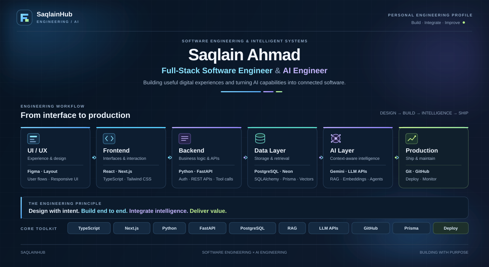

<!--
SaqlainHub | GitHub Profile README
Replace the banner URL and verify every link.
Keep only technologies and capabilities you can substantiate.
-->

  

# Saqlain Ahmad

### Full-Stack Software Engineering · AI Engineering

Building full-stack applications and AI-powered systems.

<a href="https://github.com/saqlainhub">GitHub</a> ·
<a href="https://www.saqlainhub.site">Portfolio</a> ·
<a href="mailto:saqlainhub1097@gmail.com">Email</a>

---

## About Me

I work across the frontend, backend, database, and AI layers of software applications. My focus is on integrating these components into coherent systems rather than treating them as isolated technologies.

My development work combines **TypeScript, React, Next.js, Python, FastAPI, and PostgreSQL** with LLM integration and retrieval-augmented generation (RAG).

I am interested in how software architecture, data flow, APIs, authentication, and AI components work together to create useful and maintainable applications.

### My Engineering Approach

- **Understand the system:** identify the problem, requirements, data flow, and system boundaries.
- **Design the architecture:** define responsibilities across the frontend, backend, database, and external services.
- **Implement with clarity:** use appropriate abstractions, validation, error handling, and separation of concerns.
- **Integrate and verify:** test component interactions, investigate failures, and improve reliability.
- **Keep learning:** deepen the fundamentals behind the technologies I use.

---

## Technical Expertise

### Frontend Engineering

Component-based interfaces · Responsive design · UI/UX fundamentals

### Backend & API Engineering

REST APIs · Authentication · API integration · Request validation · Application logic

### Databases & ORM

Data modeling · ORM-based persistence · Database migrations

### AI Engineering

LLM integration · Retrieval-augmented generation (RAG) · Embeddings · Knowledge retrieval · Tool calling · AI agent workflows

### Tools & Development Workflow

Version control · Documentation · Environment configuration · Testing and debugging

---

## Engineering Capabilities

| Area | Focus |
|---|---|
| Application architecture | Clear boundaries between frontend, backend, data, and external services |
| Backend development | API contracts, validation, authentication, and application logic |
| Database engineering | Relational modeling, ORM usage, persistence, and migrations |
| AI application pipelines | Document processing, retrieval, context construction, and LLM integration |
| Software quality | Readability, maintainability, debugging, and systematic verification |

---

## Current Focus

- Improving the architecture and reliability of AI-powered applications.
- Strengthening backend engineering, testing, and security practices.
- Exploring retrieval evaluation, tool orchestration, and agent workflows.
- Building deeper foundations in computer science and software design.

---

## Connect

*SaqlainHub · Engineering software, integrating AI, and learning continuously.*

